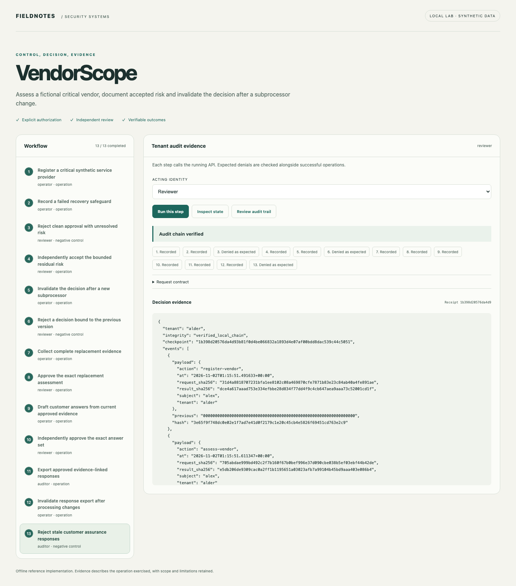
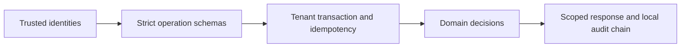

# VendorScope

[](https://github.com/jayekwere/vendorscope/actions/workflows/verify.yml) [MIT](LICENSE)

**Vendor decisions bound to the evidence and processing relationships actually reviewed.**

Register fictional vendors, assess safeguards, require explicit residual-risk decisions, invalidate approval after subprocessor changes and verify documented offboarding prerequisites.



## Run locally

Python 3.14 and Node 24 through 26. Initial dependency installation requires network access. All core demonstrations run offline after setup. Each repository is independent and ships its own lockfiles.

```sh
git clone https://github.com/jayekwere/vendorscope.git
cd vendorscope
python3 -m venv .venv
. .venv/bin/activate
python -m pip install --require-hashes -r requirements-dev.lock
npm ci --ignore-scripts
npm run build
python -m app.cli demo
python -m app.cli serve --demo
```

Open [the local workbench](http://127.0.0.1:8080). Run steps in order. The acting identity and expected denial are visible before each operation. Each step submits a real API request, and results are rendered as text. Demo credentials are public synthetic fixtures. Use them only on the private local lab.

The CLI uses temporary state and leaves the served workbench independent. The server persists its synthetic state in `artifacts/state.db`; select a new `STATE_PATH` for a fresh exercise. CLI records use a fixed observation clock where possible. The committed sample output is generated from the executable scenario, not hand-authored findings.

```sh
docker compose up --build
# Stop and discard the temporary container workspace:
docker compose down
```

Compose publishes only to loopback. It uses a non-root UID, read-only root filesystem, dropped capabilities, a private temporary state area, a memory limit and a process limit. Temporary container state is discarded when the container is removed.

## Evidence and implementation

Vendor aggregates are versioned inside a tenant transaction. Critical vendors require encryption, access reviews and recovery evidence; standard vendors require the first two. Missing evidence creates an explicit finding. A clean approval rejects unresolved findings, while a risk acceptance requires compensation and a maximum thirty-day lifetime. A decision pins the exact assessment digest and aggregate version. Region or subprocessor changes remove that decision and require replacement evidence. Offboarding records both access revocation and data disposition evidence before terminal closure.



The shared architecture pattern is small Python FastAPI domain services with SQLite transactions and a TypeScript workbench. The domain logic is specific to this project. JSON input contracts reject unknown fields and type coercion. SQL is parameterized for tenant data. All state changes and successful operation receipts commit together. Replay keys bind actor, roles, action and payload. Audit events retain digests rather than request contents. Local chains detect accidental edits; a database writer can recompute a chain, so an independent checkpoint is necessary for stronger tamper evidence.

## Verify

```sh
npm run verify
python -m ruff check app tests
python -m ruff format --check app tests
python -m mypy app
python -m pytest
npx playwright install chromium
npm run test:browser
docker build -t vendorscope:local .
node scripts/container-smoke.mjs vendorscope:local
```

Browser tests require fresh `.local/browser-state.db` state. See [verification evidence](docs/verification.md), [architecture](docs/architecture.md), [threat model](docs/threat-model.md), [security design](docs/security-design.md), [API](docs/api.md) and [schemas](schemas/contracts.json). Hosted CI enforces at least 80% Python statement/branch coverage and runs browser, dependency, exact-fixture or semantic-demo, and restricted-container checks. Coverage describes executed code and is not a security score.

## Limits

This is an assessment workflow, not independent verification of a vendor or its documents. Safeguards and evidence digests are entered by authorized operators. Tiering is an explicit illustrative policy, not a universal risk formula. Region labels document a processing inventory and do not automatically decide legal permissibility. There is no continuous external breach feed, document authenticity service or commercial GRC connector. Offboarding records reviewed assertions and does not revoke external access itself.

The service is a bounded single-node reference implementation. It supports at most 200 records per kind and 5,000 successful audit events per tenant before requiring a new workspace or deliberate archival work. Bearer identities are server-configured; there is no external identity provider, distributed scheduler, managed key service or production deployment. The offline browser interface is available only in explicit demo mode. Configured API mode requires a private identity file, accepts no demo tokens and remains intended for local evaluation. No security certification or exhaustive vulnerability guarantee is claimed.

See [SECURITY.md](SECURITY.md) and [CONTRIBUTING.md](CONTRIBUTING.md).

Customer questionnaire responses are restricted to three supported safeguard questions. Each answer is derived from the current assessment and retains its evidence digest. Unknown remains unknown. Independent approval binds the exact response set, and export rechecks the current vendor version and assessment freshness, so processing changes invalidate previous responses.
